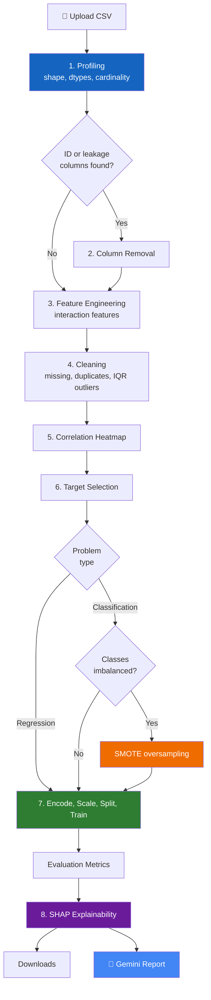
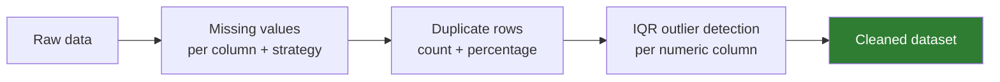
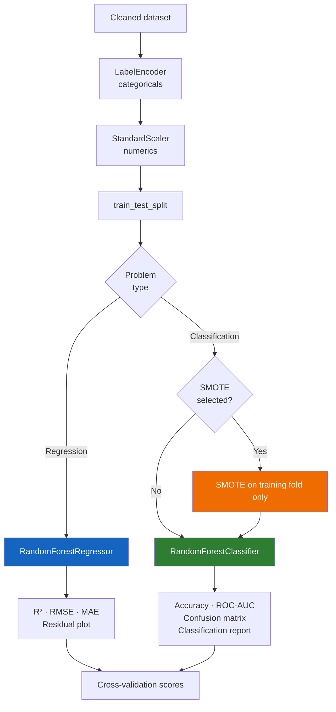
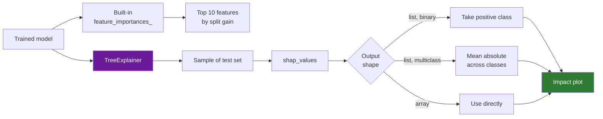

<div align="center">

# 📊 Generative AI Data Analyst

**A no-code AutoML platform: profile any CSV, clean it, train and explain a model, and get an LLM-written report — without writing a line of code.**


</div>

---

## 📌 Overview

Most AutoML tools hide everything behind one button and hand back a number. The
problem is that the decisions which actually determine whether a model is
trustworthy — did an ID column leak into the features, was the class imbalance
handled, are two features effectively the same column — all happen in the steps
that get hidden.

This application makes each of those steps **visible and adjustable**, then
trains the model, explains it with SHAP, and asks an LLM to write up what the
data says.

| | |
|---|---|
| **Problem** | Non-programmers cannot run a defensible ML workflow; one-click AutoML hides the decisions that make results trustworthy. |
| **Approach** | Eight explicit stages, each showing its findings and accepting input, before any model is fitted. |
| **Scale** | ~1,600 lines in a single Streamlit application |

---

## 📑 Table of Contents

- [The Pipeline](#-the-pipeline)
- [Stage Detail](#-stage-detail)
- [Model Training Flow](#-model-training-flow)
- [Explainability](#-explainability)
- [Design Notes](#-design-notes)
- [Project Structure](#-project-structure)
- [Tech Stack](#-tech-stack)
- [Installation](#-installation)
- [Usage](#-usage)
- [Outputs](#-outputs)
- [Known Limitations](#-known-limitations)
- [Roadmap](#-roadmap)
- [Security](#-security)

---

## 🔄 The Pipeline



---

## 🔍 Stage Detail

### 1. Profiling

Row and column counts, data types, and a per-column unique-value ratio.

Two things get flagged automatically:

- **Probable ID columns** — every value unique. These are the classic source of
  a model that scores 99% and generalises to nothing.
- **High-cardinality categoricals** — encoding these naively explodes the
  feature space.

### 2. Column removal

Drop what profiling flagged, plus anything irrelevant, before it reaches the
model.

### 3. Feature engineering

Optional interaction features built from selected numeric columns, for
relationships a tree cannot easily express as an axis-aligned split.

### 4. Cleaning



Outliers are detected with the interquartile-range rule and **reported rather
than removed automatically** — an outlier in a fraud dataset is usually the
signal, not the noise.

### 5. Correlation analysis

A heatmap across numeric columns, shown before training so redundant features
can be dropped rather than discovered afterwards in the importance plot.

### 6. Target and class imbalance

The app infers classification versus regression from the target, shows the
class distribution, and offers SMOTE when the classes are skewed.

`k_neighbors` is reduced automatically when the minority class is very small.
This is where SMOTE normally raises — the default `k_neighbors=5` cannot work
with three minority samples.

### 7. Training

Label encoding, standard scaling, train/test split, cross-validation, then a
Random Forest classifier or regressor.

---

## 🎯 Model Training Flow



### Metrics

| Problem | Metrics |
|---|---|
| **Regression** | R², RMSE, MAE, residual plot |
| **Binary classification** | Accuracy, ROC-AUC, confusion matrix, classification report |
| **Multiclass** | Accuracy, one-vs-rest ROC-AUC, confusion matrix, classification report |

---

## 🔬 Explainability



Two views are shown because they answer different questions. Built-in
importance says *which features the trees split on*. SHAP says *which features
pushed this prediction, and in which direction*. A feature can rank high on the
first and be near-useless on the second.

---

## 🧠 Design Notes

### Optional dependencies degrade gracefully

`shap` and `imbalanced-learn` are imported inside `try/except` with
`SHAP_AVAILABLE` and `SMOTE_AVAILABLE` flags:

```python
try:
    from imblearn.over_sampling import SMOTE
    SMOTE_AVAILABLE = True
except ImportError:
    SMOTE_AVAILABLE = False
```

A missing package disables that one feature and explains how to install it,
instead of killing the app at import. On a demo machine that is the difference
between a working app and a stack trace on the projector.

### Multiclass SHAP shapes are handled explicitly

`shap_values` returns a list for multiclass models and an array for binary
ones, and the shapes differ again across SHAP versions. The code normalises all
three cases before plotting — the most common source of `IndexError` in
SHAP-based projects.

### The LLM never touches the modelling

Gemini writes the narrative report **from computed metrics**. Every number
comes from scikit-learn. The model cannot invent a figure the pipeline did not
produce, and results stay reproducible.

### The app works without an API key

No key means the AI report section is disabled. Everything else — profiling,
cleaning, training, evaluation, SHAP, exports — runs normally.

---

## 📂 Project Structure

```
ai-data-analyst/
│
├── src/
│   ├── app.py                    # The Streamlit application (~1,600 lines)
│   ├── model.ipynb               # Model development
│   ├── explain.ipynb             # SHAP exploration
│   ├── feature_engineering.ipynb
│   └── .env                      # GEMINI_API_KEY — never commit
│
├── notebooks/
│   └── EDA.ipynb                 # Exploratory analysis
│
├── data/
│   └── House Price India.csv     # Sample dataset
│
├── models/
│   └── best_model.pkl            # Saved model (gitignored — large)
│
├── docs/
│   └── screenshots/
│
└── requirements.txt
```

---

## 🛠 Tech Stack

| Layer | Technology | Role |
|---|---|---|
| Interface | Streamlit | Upload, controls, plots, downloads |
| Data | pandas, NumPy | Profiling and transformation |
| Modelling | scikit-learn | Random Forest, split, CV, metrics |
| Imbalance | imbalanced-learn | SMOTE oversampling *(optional)* |
| Explainability | SHAP | TreeExplainer impact analysis *(optional)* |
| Visualisation | Matplotlib | Heatmaps, residuals, confusion matrix |
| LLM | Google Gemini | Natural-language report |
| Persistence | pickle | Model and scaler export |

---

## 📸 Screenshots

Place captures in `docs/screenshots/` and reference them here:

```markdown


```

Worth capturing: the ID-leakage warning, the class-distribution chart with the
SMOTE option, the SHAP plot, and the generated report.

---

## 🚀 Installation

```bash
git clone https://github.com/<your-username>/ai-data-analyst.git
cd ai-data-analyst

python -m venv .venv
.venv\Scripts\activate          # Windows
# source .venv/bin/activate     # macOS / Linux

pip install -r requirements.txt
```

**requirements.txt**

```
streamlit
pandas
numpy
matplotlib
scikit-learn
shap                    # optional — enables explainability
imbalanced-learn        # optional — enables SMOTE
google-generativeai
python-dotenv
```

Create `src/.env`:

```env
GEMINI_API_KEY=your_key_here
```

Run:

```bash
streamlit run src/app.py
```

---

## 💡 Usage

1. **Upload a CSV.** A sample dataset ships in `data/`.
2. **Read the profile.** Act on any ID-leakage or high-cardinality warnings.
3. **Drop columns** that leak or are irrelevant.
4. **Add interaction features** if two numerics plausibly combine.
5. **Clean** — choose a missing-value strategy, review duplicates and outliers.
6. **Check the correlation heatmap** and drop redundant features.
7. **Select the target.** For skewed classification, enable SMOTE.
8. **Train**, then read metrics, feature importances and SHAP.
9. **Download** the artifacts and generate the AI report.

### Dataset requirements

| Requirement | Note |
|---|---|
| Format | CSV |
| Structure | Tabular, one header row |
| Target | A single column, numeric or categorical |
| Size | Fits in memory — a few hundred thousand rows is comfortable |

---

## 📦 Outputs

| Artifact | Format | Use |
|---|---|---|
| Cleaned dataset | CSV | Reuse the preprocessing elsewhere |
| Predictions | CSV | Compare against actuals |
| Trained model | pickle | Load for inference |
| Fitted scaler | pickle | **Required** — new data must use the same scaler |
| AI report | Text | Summary of quality, trends and recommendations |

> Exporting the scaler alongside the model is not optional. A model fed
> unscaled or differently-scaled data at inference time produces silently wrong
> predictions rather than an error.

---

## ⚠️ Known Limitations

- **Random Forest only.** No model comparison, no hyperparameter search.
- **Tabular only** — no text, image or time-series handling.
- **In-memory.** Very large files will struggle.
- **SHAP runs on a sample** of the test set for speed, so values are
  approximate.
- **No three-way split.** Cross-validation covers stability, but there is no
  held-out validation set separate from the test set.
- **Single-user.** No session isolation if deployed publicly.

---

## 🗺 Roadmap

- [ ] Model comparison — XGBoost, LightGBM, Logistic/Linear baselines
- [ ] Hyperparameter search with `GridSearchCV` / `Optuna`
- [ ] Automatic train/validation/test three-way split
- [ ] Time-series support with chronological splitting
- [ ] Persist the full preprocessing pipeline, not just the scaler
- [ ] PDF export of the AI report
- [ ] Batch inference against an uploaded model

---

## 🔒 Security

`src/.env` contains a live API key, and `models/best_model.pkl` can be very
large. Add both to `.gitignore` **before the first commit** — GitHub rejects
files over 100 MB, and a committed API key can be scraped within minutes.

```gitignore
.env
.venv/
models/*.pkl
data/*.csv
__pycache__/
*.pyc
.ipynb_checkpoints/
```

<div align="center">

**Built by [Akhil Reddy Sankati](https://github.com/akhil2203031050881)**

[LinkedIn](https://linkedin.com/in/akhil-reddy-sankati-ba5212320) · akhilreddysankati1328@gmail.com

</div>
